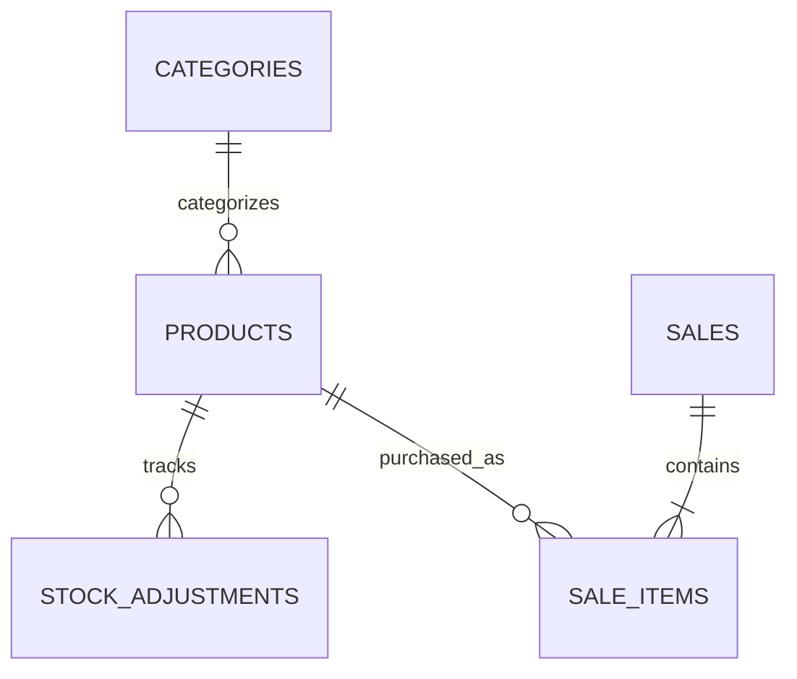

# ☕ Bean Coffee POS

A coffee shop Point of Sale (POS) system built with **ASP.NET Core Web API, PostgreSQL, and React**. The project aims to provide product and category management, inventory tracking, cash transactions, and sales history through a modular and maintainable architecture.

> **Project status:** Backend product, category, and inventory management implemented. Sales functionality is planned for Phase 06.

## Project Overview

Bean Coffee POS is designed to help coffee shops manage their products, monitor inventory, and process customer purchases. The system is being developed incrementally, with a focus on data integrity, transaction safety, and maintainable code.

### Goals

- Manage coffee shop products and categories.
- Track current stock quantities.
- Maintain an audit trail of inventory changes.
- Process cash sales and calculate customer change.
- Automatically deduct sold quantities from inventory.
- Preserve historical transaction and product pricing data.
- Provide a foundation for future reporting and POS frontend features.

## 🛠️ Technology Stack

| Technology | Purpose |
|---|---|
| C# | Backend programming language |
| ASP.NET Core Web API (.NET 10) | REST API and business logic |
| Entity Framework Core | ORM and database migrations |
| PostgreSQL | Relational database |
| Npgsql | PostgreSQL provider for EF Core |
| Swagger / OpenAPI | API documentation and testing |
| React | Planned POS frontend |
| Git and GitHub | Version control and source management |

## ✅ Implemented Features

### Product Management
- Create, retrieve, update, and delete products.
- Store product names, prices, availability, categories, and stock quantities.
- Validate product input and category references.

### Category Management
- Create, retrieve, update, and delete categories.
- Prevent duplicate category names.
- Prevent deleting categories that are assigned to products.

### Inventory Management
- Track stock quantities for individual products.
- Add or remove stock through inventory adjustment endpoints.
- Record stock before and after an adjustment.
- Require a reason for each adjustment.
- Reject adjustments that would result in negative inventory.
- Use database transactions and PostgreSQL row locking for stock adjustments.

### Database and Development
- PostgreSQL database integration.
- Entity Framework Core migrations.
- API and database health endpoints.
- Swagger API documentation.
- Git-based version control.

## 🗺️ Development Roadmap

| Phase | Scope | Status |
|---|---|---|
| Product API | Product CRUD and validation | Implemented |
| Category API | Category CRUD and relationships | Implemented |
| Inventory Tracking | Stock quantity and adjustment history | Implemented |
| Phase 06A | Sales and sale-item database schema | Planned / in progress |
| Phase 06B | Cash sales API and transactional stock deduction | Planned |
| Phase 06C | Sales history endpoints | Planned |
| Phase 06D | Sales testing and verification | Planned |
| Future | React checkout UI, receipts, reports, discounts | Planned |

## 🗄️ Database Schema

### Existing Tables

#### 1. `Categories`

Stores product categories.

| Column | Description |
|---|---|
| `Id` | Primary key |
| `Name` | Category name; unique |
| `Description` | Optional category description |
| `CreatedAt` | Creation timestamp |

#### 2. `Products`

Stores coffee shop products and their current inventory.

| Column | Description |
|---|---|
| `Id` | Primary key |
| `Name` | Product name |
| `Price` | Current product price |
| `IsAvailable` | Product availability |
| `StockQuantity` | Current stock quantity |
| `CreatedAt` | Creation timestamp |
| `CategoryId` | Optional foreign key to `Categories` |

#### 3. `StockAdjustments`

Stores the history of inventory adjustments.

| Column | Description |
|---|---|
| `Id` | Primary key |
| `ProductId` | Foreign key to `Products` |
| `QuantityChange` | Positive for additions; negative for removals |
| `StockBefore` | Stock quantity before adjustment |
| `StockAfter` | Stock quantity after adjustment |
| `Reason` | Explanation for the adjustment |
| `CreatedAt` | Adjustment timestamp |

### Proposed Sales Tables

The following tables are planned for Phase 06. They should be marked as implemented only after the corresponding migration has been applied and verified.

#### 4. `Sales`

Stores the overall details of each transaction.

| Column | Description |
|---|---|
| `Id` | Primary key and transaction identifier |
| `TotalAmount` | Server-calculated transaction total |
| `CashReceived` | Amount of cash received |
| `ChangeDue` | Change returned to the customer |
| `CreatedAt` | Transaction timestamp |

#### 5. `SaleItems`

Stores the products included in each sale.

| Column | Description |
|---|---|
| `Id` | Primary key |
| `SaleId` | Foreign key to `Sales` |
| `ProductId` | Foreign key to `Products` |
| `Quantity` | Quantity sold |
| `UnitPrice` | Product price captured at the time of sale |
| `LineTotal` | Quantity multiplied by unit price |

### Entity Relationships



**Note:** The `Sales` and `SaleItems` relationships represent the proposed sales design until Phase 06 is implemented.

## 🔌 API Endpoints

Base URL for local development:

`http://localhost:5080`

### Health

| Method | Endpoint | Description |
|---|---|---|
| GET | `/api/health` | API health check |
| GET | `/api/health/database` | Database connectivity check |

### Products

| Method | Endpoint | Description |
|---|---|---|
| GET | `/api/products` | Retrieve all products |
| GET | `/api/products/{id}` | Retrieve a product |
| POST | `/api/products` | Create a product |
| PUT | `/api/products/{id}` | Update a product |
| DELETE | `/api/products/{id}` | Delete a product |

### Categories

| Method | Endpoint | Description |
|---|---|---|
| GET | `/api/categories` | Retrieve all categories |
| GET | `/api/categories/{id}` | Retrieve a category |
| POST | `/api/categories` | Create a category |
| PUT | `/api/categories/{id}` | Update a category |
| DELETE | `/api/categories/{id}` | Delete a category |

### Inventory

| Method | Endpoint | Description |
|---|---|---|
| GET | `/api/products/{id}/stock-adjustments` | Retrieve a product's stock history |
| POST | `/api/products/{id}/stock-adjustments` | Create a stock adjustment |

Sales endpoints will be documented here after their implementation and testing.

## Local Development Setup

### Prerequisites

- macOS, Windows, or Linux
- .NET 10 SDK
- PostgreSQL
- Entity Framework Core CLI tools
- Git

### 1. Clone the repository

```bash
git clone https://github.com/Larcadeee/Bean-Coffee-POS.git
cd Bean-Coffee-POS
```

### 2. Restore dependencies

```bash
cd backend/Bean.Api
dotnet restore
dotnet build
```

### 3. Configure the database connection

Use .NET User Secrets for local development rather than committing database credentials.

```bash
dotnet user-secrets set "ConnectionStrings:DefaultConnection" "Host=localhost;Port=5432;Database=bean_pos;Username=YOUR_USERNAME;Password=YOUR_PASSWORD"
```

Replace the placeholders with your local PostgreSQL credentials.

### 4. Apply database migrations

```bash
dotnet ef database update
```

### 5. Run the API

From `backend/Bean.Api`:

```bash
ASPNETCORE_ENVIRONMENT=Development dotnet run --no-launch-profile --urls http://localhost:5080
```

### 6. Verify the API

Check database connectivity:

```bash
curl -i http://localhost:5080/api/health/database
```

Open Swagger in your browser:

`http://localhost:5080/swagger`

> Run migrations before starting the application against a new database. Ensure PostgreSQL is running and the connection string is configured correctly.

## Security and Data Integrity

- Keep database credentials and secrets out of source control.
- Validate API requests on the server.
- Calculate sale totals using trusted database product prices.
- Validate stock before completing sales.
- Use database transactions to keep sale records, inventory updates, and adjustment history consistent.
- Preserve transaction history and product prices for accurate records.

The transactional sales safeguards are part of the planned Phase 06 implementation.

## 📁 Backend Project Structure

```text
Bean-Coffee-POS/
├── backend/
│   └── Bean.Api/
│       ├── Data/
│       │   └── BeanDbContext.cs
│       ├── DTOs/
│       ├── Migrations/
│       ├── Models/
│       │   ├── Category.cs
│       │   ├── Product.cs
│       │   └── StockAdjustment.cs
│       ├── Program.cs
│       └── Bean.Api.csproj
├── .gitignore
└── README.md
```

The frontend directory and additional files may be added as development progresses.

## Current Development Focus

**Phase 06 — Sales Backend**

The next milestone is to introduce the `Sales` and `SaleItems` tables, implement cash-only transactions, calculate change, deduct inventory safely, and record sale-related stock adjustments.

Discounts, receipt generation, sales reports, and the complete React POS interface are planned for later development.

## Author

Developed as a learning and portfolio project focused on backend engineering, REST API development, relational database design, and inventory management.
