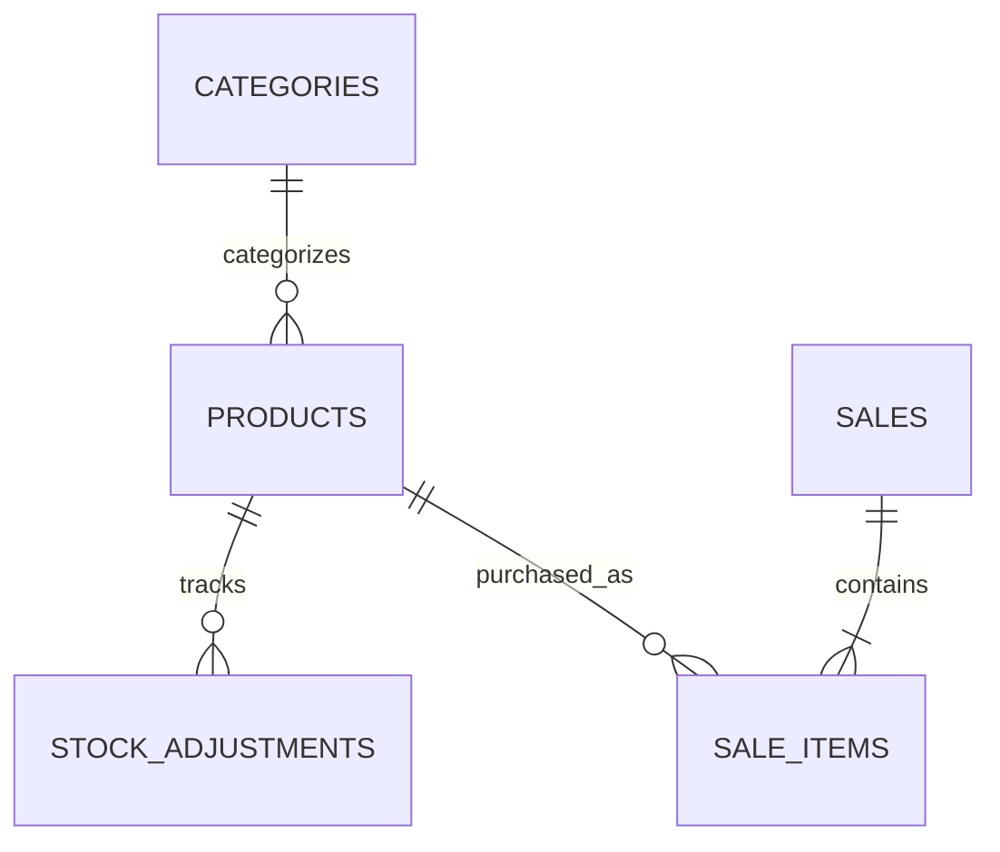
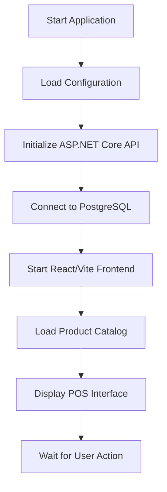
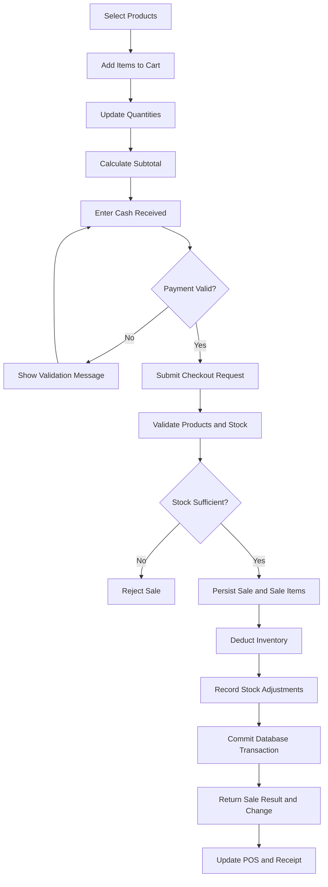
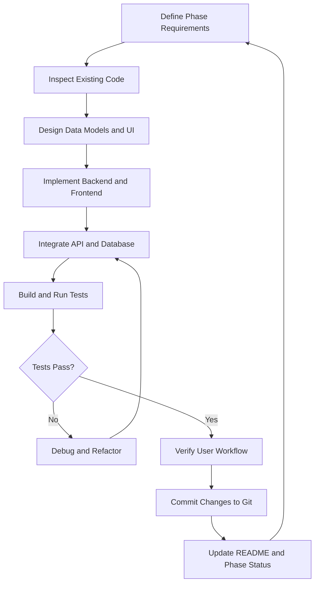

# ☕ Bean Coffee POS

A coffee shop Point of Sale (POS) system built with **ASP.NET Core Web API, PostgreSQL, Entity Framework Core, and React**. The system provides product catalog management, category management, cash checkout, receipt records, inventory tracking, and a modern POS interface.

> **Project status:** Phase 9 — Tailwind CSS redesign completed; Phase 10 — Inventory Management is the current development focus. Core frontend and backend integration, product catalog loading, cash checkout, sales persistence, and transactional inventory deduction have been implemented according to the current development progress.

---

## 📌 Project Overview

Bean Coffee POS is designed to streamline everyday coffee shop operations through a modular, maintainable, and database-driven application.

The system connects a React frontend to an ASP.NET Core REST API, which communicates with PostgreSQL through Entity Framework Core. Business rules and database operations are handled by the backend to maintain consistent product, sales, and inventory records.

### Project Goals

- Manage products and product categories.
- Display available products in a responsive POS interface.
- Add products to a shopping cart and update quantities.
- Process cash payments and calculate customer change.
- Save completed sales and their corresponding sale items.
- Automatically deduct sold quantities from inventory.
- Record inventory adjustments and preserve stock history.
- Provide inventory monitoring and low-stock indicators.
- Maintain a consistent interface for POS users and administrators.
- Establish a foundation for sales reports, authentication, and deployment.

## 🛠️ Technology Stack

| Technology | Purpose |
|---|---|
| C# | Backend programming language |
| ASP.NET Core Web API (.NET 10) | REST API and business logic |
| Entity Framework Core | ORM, database access, and migrations |
| PostgreSQL | Relational database |
| Npgsql | PostgreSQL database provider |
| Swagger / OpenAPI | API documentation and testing |
| React | POS and management interface |
| Vite | Frontend development server and build tooling |
| Tailwind CSS | Frontend styling and responsive layout |
| JavaScript / JSX | Frontend application logic |
| ESLint | Frontend code quality and linting |
| Git and GitHub | Version control and source management |

## ✅ Implemented Features

### 1. Product Management API

- Create, retrieve, update, and delete products.
- Store product names, prices, availability, stock quantities, and category references.
- Validate product input and category relationships.
- Provide product data to the frontend through the REST API.

### 2. Category Management API

- Create, retrieve, update, and delete categories.
- Prevent duplicate category names.
- Prevent deleting categories assigned to existing products.
- Associate products with their respective categories.

### 3. Inventory Backend

- Maintain stock quantities for individual products.
- Support stock additions and removals through inventory adjustment endpoints.
- Record stock quantities before and after adjustments.
- Require a reason for each adjustment.
- Reject adjustments that would result in negative stock.
- Use database transactions and PostgreSQL row locking for stock adjustments.

### 4. React POS Frontend

- React and Vite frontend setup.
- Integration with the ASP.NET Core API.
- PostgreSQL-backed product catalog through the API.
- Product catalog loading in the POS interface.
- Shopping cart with quantity updates.
- Frontend and backend communication configured through CORS.
- Tailwind CSS interface redesign.
- Responsive layout improvements for the POS workflow.

### 5. Cash Checkout

- Calculate the cart subtotal.
- Accept cash received from the customer.
- Validate payment amounts before completing checkout.
- Calculate the customer's change.
- Save completed sales and associated sale items.
- Deduct sold quantities from product inventory.
- Record sale-related stock adjustments.
- Preserve the unit price captured at the time of sale.

### 6. Database and Development Infrastructure

- PostgreSQL database integration.
- Entity Framework Core migrations.
- Product, category, inventory, and sales data models.
- API and database health endpoints.
- Swagger API documentation.
- Git-based source control and development checkpoints.

## 🗺️ Development Roadmap

The project follows an incremental development process. Each phase builds on the functionality completed in earlier phases.

| Phase | Scope | Status |
|---|---|---|
| Phase 1 | Project initialization and backend setup | Completed |
| Phase 2 | PostgreSQL and Entity Framework Core integration | Completed |
| Phase 3 | Product API and validation | Completed |
| Phase 4 | Category API and relationships | Completed |
| Phase 5 | Inventory foundation and stock adjustment history | Completed |
| Phase 6 | React/Vite integration, API connectivity, and product catalog | Completed |
| Phase 7 | Shopping cart, cash checkout, sales persistence, and stock deduction | Implemented |
| Phase 8 | Admin dashboard and product management, including POS/admin synchronization | In progress |
| Phase 9 | Tailwind CSS redesign and UI improvements | Completed |
| Phase 10 | Inventory management, stock-in/out, history, and stock alerts | Current phase |
| Phase 11 | Sales history and reporting | Planned |
| Phase 12 | Authentication, authorization, and deployment | Planned |

**Note:** Phase completion refers to the current development progress. Final acceptance should be based on actual source code, database migrations, and end-to-end testing.

### Phase 8 — Admin Dashboard and Product Management

The management interface builds on the existing product and category APIs.

Planned or continuing work includes:

- Administrative dashboard layout.
- Product listing and management interface.
- Product creation and editing forms.
- Category management interface.
- Synchronization between administrative changes and the POS catalog.
- Clear validation and error messages.

### Phase 9 — Tailwind CSS Redesign

The redesign improves the presentation and usability of the existing application without replacing its established business logic.

Focus areas include:

- Consistent typography, spacing, and component styling.
- Improved product catalog and cart presentation.
- Better checkout layout and payment feedback.
- Responsive page layouts.
- Consistent styling across POS and administrative screens.

### Phase 10 — Inventory Management

The current phase expands inventory functionality while retaining the existing stock-adjustment API as the authoritative backend mechanism.

Scope:

- Stock-in and stock-out operations.
- Required reasons for manual adjustments.
- Inventory adjustment history.
- Low-stock and out-of-stock alerts.
- Protection against negative inventory.
- Prevention of sales for unavailable or insufficiently stocked products.
- Synchronization between inventory changes and the POS product catalog.
- Validation of stock quantities on the server.

### Phase 11 — Sales History and Reports

Planned features:

- Sales transaction history.
- Individual sale details and purchased items.
- Sales summaries by date.
- Daily and monthly revenue reports.
- Product sales summaries.
- Transaction lookup and reporting filters.

### Phase 12 — Authentication and Deployment

Planned features:

- User authentication.
- Role-based authorization for administrative and cashier functions.
- Secure configuration and environment variables.
- Production database configuration.
- Frontend and backend deployment.
- Production API connectivity and CORS configuration.
- Final end-to-end testing.

## 🗄️ Database Schema

The following tables describe the current data model and the sales design. Confirm the actual applied migrations before treating every column or constraint as part of the production schema.

### 1. `Categories`

Stores product categories.

| Column | Description |
|---|---|
| `Id` | Primary key |
| `Name` | Category name; intended to be unique |
| `Description` | Optional category description |
| `CreatedAt` | Creation timestamp |

### 2. `Products`

Stores products and their current inventory.

| Column | Description |
|---|---|
| `Id` | Primary key |
| `Name` | Product name |
| `Price` | Current product price |
| `IsAvailable` | Product availability |
| `StockQuantity` | Current stock quantity |
| `CreatedAt` | Creation timestamp |
| `CategoryId` | Optional foreign key to `Categories` |

### 3. `StockAdjustments`

Records changes to inventory.

| Column | Description |
|---|---|
| `Id` | Primary key |
| `ProductId` | Foreign key to `Products` |
| `QuantityChange` | Positive for additions; negative for removals |
| `StockBefore` | Stock quantity before adjustment |
| `StockAfter` | Stock quantity after adjustment |
| `Reason` | Explanation for the adjustment |
| `CreatedAt` | Adjustment timestamp |

### 4. `Sales`

Stores completed transaction details.

| Column | Description |
|---|---|
| `Id` | Primary key and transaction identifier |
| `TotalAmount` | Server-calculated transaction total |
| `CashReceived` | Amount of cash received |
| `ChangeDue` | Change returned to the customer |
| `CreatedAt` | Transaction timestamp |

### 5. `SaleItems`

Stores the products included in each sale.

| Column | Description |
|---|---|
| `Id` | Primary key |
| `SaleId` | Foreign key to `Sales` |
| `ProductId` | Foreign key to `Products` |
| `Quantity` | Quantity sold |
| `UnitPrice` | Product price captured at the time of sale |
| `LineTotal` | Quantity multiplied by unit price |

### Entity Relationships



**Data integrity:** The backend should calculate transaction totals using trusted product prices, validate stock before completing a sale, and execute sale persistence and inventory deductions within a consistent transaction boundary.

Historical sale-item prices should remain unchanged when a product's current selling price is updated.

## 🔌 API Endpoints

Base URL for local development:

`http://localhost:5080`

### Health

| Method | Endpoint | Description |
|---|---|---|
| GET | `/api/health` | API health check |
| GET | `/api/health/database` | Database connectivity check |

### Products

| Method | Endpoint | Description |
|---|---|---|
| GET | `/api/products` | Retrieve products |
| GET | `/api/products/{id}` | Retrieve a specific product |
| POST | `/api/products` | Create a product |
| PUT | `/api/products/{id}` | Update a product |
| DELETE | `/api/products/{id}` | Delete a product |

### Categories

| Method | Endpoint | Description |
|---|---|---|
| GET | `/api/categories` | Retrieve categories |
| GET | `/api/categories/{id}` | Retrieve a specific category |
| POST | `/api/categories` | Create a category |
| PUT | `/api/categories/{id}` | Update a category |
| DELETE | `/api/categories/{id}` | Delete a category |

### Inventory

| Method | Endpoint | Description |
|---|---|---|
| GET | `/api/products/{id}/stock-adjustments` | Retrieve stock adjustment history |
| POST | `/api/products/{id}/stock-adjustments` | Create a stock adjustment |

### Sales

The sales API supports the checkout workflow, including saving sale records, sale items, and corresponding inventory changes.

Document the exact sales routes from the implemented sales controller before publishing endpoint paths. Avoid documenting unverified routes.

## 📁 Project Structure

The following is a high-level representation of the project. Update individual filenames to match the current repository as new modules are added.

```text
Bean-Coffee-POS/
├── backend/
│   └── Bean.Api/
│       ├── Data/
│       │   └── BeanDbContext.cs
│       ├── DTOs/
│       ├── Migrations/
│       ├── Models/
│       │   ├── Category.cs
│       │   ├── Product.cs
│       │   └── StockAdjustment.cs
│       ├── Controllers/
│       ├── Services/
│       ├── Program.cs
│       └── Bean.Api.csproj
├── frontend/
│   ├── src/
│   │   ├── components/
│   │   ├── pages/
│   │   ├── services/
│   │   ├── hooks/
│   │   ├── App.jsx
│   │   └── main.jsx
│   ├── public/
│   ├── package.json
│   ├── vite.config.js
│   └── index.html
├── .gitignore
└── README.md
```

The structure separates backend responsibilities from frontend presentation:

- **Models:** Represent database entities.
- **DTOs:** Define data exchanged between API clients and the backend.
- **Data:** Contains database context and persistence configuration.
- **Migrations:** Track database schema changes.
- **Controllers:** Expose HTTP endpoints.
- **Services:** Encapsulate business rules when implemented.
- **Components:** Provide reusable React UI elements.
- **Pages:** Organize major application screens.
- **Services (frontend):** Centralize API requests and backend communication.
- **Hooks:** Hold reusable React state and behavior.

The actual repository structure takes precedence over this illustrative layout.

## 🔄 System Lifecycle

### Application Startup



### Checkout Lifecycle



The intended checkout process must preserve data consistency. If any critical database operation fails, the backend should roll back the transaction rather than leave an incomplete sale or an inconsistent stock quantity.

## 🔁 Development Process and Code-Building Loop

Bean Coffee POS follows an iterative development process instead of building the entire application in one step.



Each development cycle follows these principles:

1. **Define:** Identify the requirements and acceptance criteria for the phase.
2. **Inspect:** Review the existing files, components, API routes, and database schema.
3. **Design:** Plan the necessary changes before modifying the code.
4. **Implement:** Build only the functionality required for the current milestone.
5. **Integrate:** Connect the frontend, backend, and database.
6. **Test:** Run builds, linting, API tests, and relevant workflow checks.
7. **Debug:** Correct errors and regression issues before continuing.
8. **Verify:** Confirm that the feature works from the user's perspective.
9. **Commit:** Save a stable checkpoint in Git.
10. **Document:** Update the README, project structure, and phase status.

After documentation is updated, the next development phase begins using the existing codebase. Previous working features should be preserved unless a deliberate refactor requires changes.

## 🚀 Local Development Setup

### Prerequisites

- macOS, Windows, or Linux
- .NET 10 SDK
- Node.js and npm compatible with the project's Vite dependencies
- PostgreSQL
- Entity Framework Core CLI tools
- Git

### 1. Clone the Repository

```bash
git clone https://github.com/Larcadeee/Bean-Coffee-POS.git
cd Bean-Coffee-POS
```

### 2. Configure the Backend

```bash
cd backend/Bean.Api
dotnet restore
dotnet build
```

### 3. Configure the Database Connection

Use .NET User Secrets for local development.

```bash
dotnet user-secrets set "ConnectionStrings:DefaultConnection" "Host=localhost;Port=5432;Database=bean_pos;Username=YOUR_USERNAME;Password=YOUR_PASSWORD"
```

Replace the placeholders with your local PostgreSQL credentials.

### 4. Apply Database Migrations

```bash
dotnet ef database update
```

If the EF Core CLI is not installed, install it using:

```bash
dotnet tool install --global dotnet-ef
```

If it is already installed, update it only when needed and ensure its version is compatible with the project's EF Core packages.

### 5. Start the Backend API

From `backend/Bean.Api`:

```bash
ASPNETCORE_ENVIRONMENT=Development dotnet run --no-launch-profile --urls http://localhost:5080
```

### 6. Start the Frontend

Open a second terminal and navigate to the actual frontend directory.

```bash
cd frontend
npm install
npm run dev
```

If the frontend directory is named differently in your repository, use its actual path.

### 7. Verify the Application

Check the database health endpoint:

```bash
curl -i http://localhost:5080/api/health/database
```

Open Swagger:

`http://localhost:5080/swagger`

Open the local frontend URL displayed by Vite in the terminal.

Verify that products load, cart quantities update, checkout validation works, completed sales are saved, and inventory quantities remain consistent.

## 🔐 Security and Data Integrity

- Keep database credentials and API secrets out of source control.
- Use environment-specific configuration.
- Validate request data